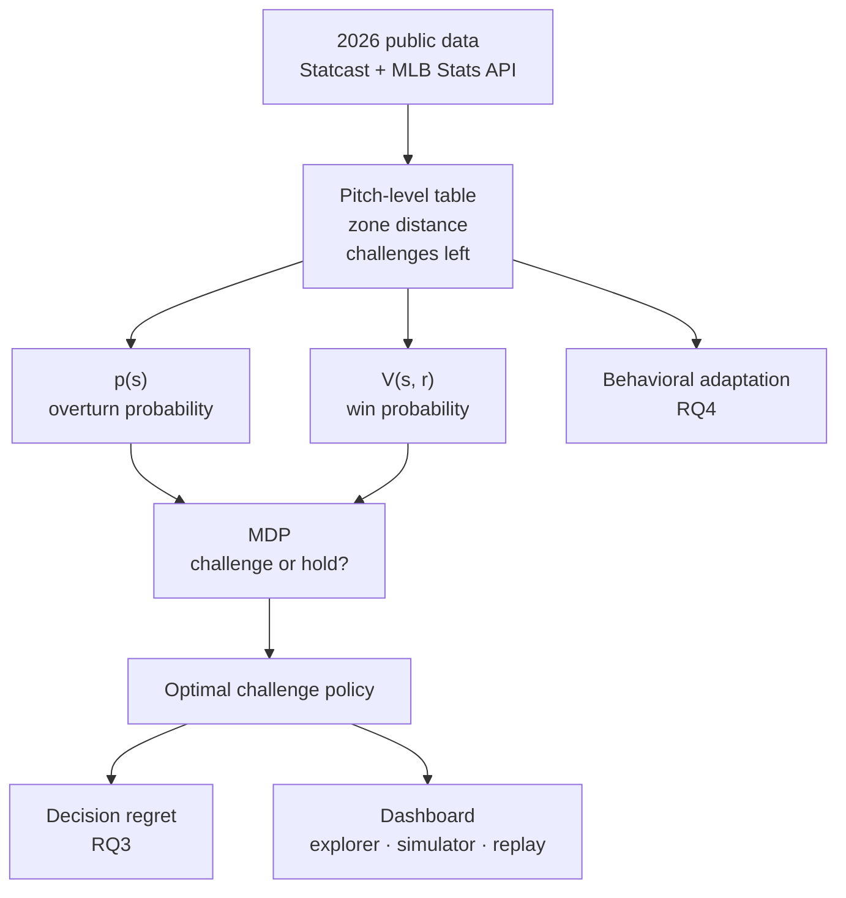

# Optimal Challenge Policies under MLB's ABS System

*Optimal Challenge Policies, Decision Regret, and Behavioral Adaptation under
MLB's Automated Ball-Strike (ABS) System*

Master's capstone · Melissa Martinez · Fall 2026 – Spring 2027

> **Status, October 2026:** data pipeline and analytic cohort complete ·
> overturn-probability modeling in progress · final poster presentation
> April 26, 2027

<!-- When GitHub Pages is on, add a link to the live dashboard here, e.g.
**[Live dashboard →](https://YOUR-USERNAME.github.io/YOUR-REPO/dashboard/)** -->

In 2026, MLB gave every team two ball-strike challenges per game. A successful
challenge is kept; a failed one is gone. That turns every borderline call into a
decision made within seconds: **challenge now, or save it for a bigger moment?**

This project builds the framework to answer that question optimally. It then
uses the answer to measure how good teams' real decisions were, and how
behavior changed over the first season of the system.

---

## Why it matters

- **Success rate is the wrong scorecard.** Two challenges with the same chance of
  succeeding can be worth very different amounts: one in a blowout, one with the
  game on the line. The right decision depends on the probability of an overturn
  *and* on what the call is worth in win probability.
- **The decision is sequential.** Using a challenge now has an opportunity cost,
  the chance it would have been worth more later. That cost changes with the
  inning, the score and how many challenges are left.
- **It can be evaluated.** With an optimal policy in hand, every real 2026
  challenge, and every challenge not made, can be scored against it. That shows
  which players and teams leave value on the table.

---

## Research questions

| | Question | Semester |
|---|---|---|
| **RQ1** | **What is the optimal ABS challenge strategy?** Given the game state, challenges remaining, and the probability the call is overturned, when should a team challenge rather than hold? | Fall 2026 → Spring 2027 |
| **RQ2** | **What is a challenge worth?** How much does overturning a call change a team's win probability, and how should that be weighed against saving the challenge? | Fall 2026 |
| **RQ3** | **How close did teams come to optimal?** How closely did 2026 challenge decisions follow the optimal policy, and what was the resulting decision regret? | Spring 2027 |
| **RQ4** | **Did behavior adapt?** Did players, catchers and umpires change during the first season of ABS challenges? | Spring 2027 |

---

## Approach

At every challenge opportunity, a team compares two actions:

```math
Q_{\text{challenge}}(s,r) \;=\; p(s)\,V\!\left(s_{\text{overturned}},\, r\right) \;+\; \bigl(1-p(s)\bigr)\,V\!\left(s_{\text{stand}},\, r-1\right)
```

```math
Q_{\text{hold}}(s,r) \;=\; V\!\left(s_{\text{stand}},\, r\right)
```

- ***s*** is the game state (inning, score, outs, runners, count) and ***r*** is
  the number of challenges remaining.
- ***p(s)*** is the **probability ABS overturns the call**: a calibrated model
  trained on 2026 challenges.
- ***V*** is the **probability of winning** from a game state: a win-expectancy
  model.
- Only the failure branch spends a challenge (*r* − 1), because successful
  challenges are kept.

Challenge when *Q*<sub>challenge</sub> > *Q*<sub>hold</sub>. Equivalently,
challenge when *p(s)* clears a threshold that depends on the game state. Across
a full game this is a **finite-horizon Markov decision process**, solved by
backward induction (dynamic programming). That method was chosen over
black-box reinforcement learning so the challenge inventory, the opportunity
cost and the value of future challenges stay explicit and explainable.



### Design principles

- **Calibration over discrimination.** *p(s)* is compared against a decision
  threshold, so a model that ranks pitches well but misstates their probabilities
  produces the wrong policy. Models are graded first on Brier score, calibration
  intercept and slope, and reliability diagrams, and only then on AUC.
- **Time-based validation.** Train on March–July, validate on August, and test
  on September, which stays sealed until final evaluation. This mirrors how a
  club would use the model mid-season.
- **Leakage controls.** Every feature is known before the challenge resolves.
  Umpire and catcher tendencies are computed from the training window only.
- **Tested like software.** Metrics and models are checked against known
  answers, and the full pipeline is run on simulated seasons with planted effects
  to confirm it recovers them.
- **Reproducible.** Data pulls are versioned and resumable, every derived field
  is documented, and a demo mode runs the whole pipeline on a synthetic season.

---

## Data

All public, 2026 regular season:

| Source | What it provides |
|---|---|
| Statcast (Baseball Savant, via `pybaseball`) | every pitch: location, type, velocity, movement, count, game state |
| MLB Stats API | challenge events (who challenged, the call, the outcome), umpire assignments, player heights, win probability and leverage |
| Baseball Savant leaderboards | ABS challenge aggregates (for validation) and catcher framing |

These are joined into **one pitch-level table (~720,000 pitches)** with two
fields that no public source provides directly:

- **Challenges remaining** for both teams before every pitch. It's reconstructed
  by replaying each game under the 2026 rules: two per team, successful
  challenges kept, and one extra per inning in extras for a team that has run out.
- **Distance to the ABS zone edge** under the 2026 definition: 17 inches wide,
  27%–53.5% of the batter's height, and a strike if any part of the ball touches
  the zone. Statcast's stance-based zone is a different definition and isn't
  used.

No raw data is stored in this repository. The scripts pull it from the public
sources above, which are subject to MLB's terms of use.

---

## Timeline and milestones

Status as of October 2026. The full week-by-week fall plan is in
[`WEEKLY_PLAN.md`](WEEKLY_PLAN.md).

### Fall 2026: build and validate the foundation

| Date | Milestone | Status |
|---|---|---|
| Sep 4 | Proposal submitted: scope and research questions set with supervisor | Done |
| Sep 18 | Data feasibility confirmed: challenge-to-pitch join, source inventory, risk register | Done |
| Sep 25 | Versioned, resumable ingestion pipeline | Done |
| Oct 2 | Analysis-ready pitch-level table, data dictionary and automated QA checks | Done |
| Oct 9 | Analytic cohort frozen with a temporal train / validate / test split | Done |
| **Oct 16** | **Baseline overturn models (logistic regression, GAM) with a calibration-first evaluation** | **In progress** |
| Oct 23 | Gradient-boosted models (CatBoost, LightGBM) compared against the baseline | Planned |
| Oct 30 | Locked, calibrated overturn-probability model *p(s)* with model card | Planned |
| Nov 6 | Validated win-probability model *V(s)* and call-outcome transition tables | Planned |
| Nov 13 | MDP specification, dynamic-programming solver and first challenge-threshold policy | Planned |
| Nov 20 | Dashboard v0 and interim research memo | Planned |
| Dec 4 | Fall research package to supervisor | Planned |

### Spring 2027: optimal policy, decision regret, behavior

| Date | Milestone | Status |
|---|---|---|
| Jan 29 | Data refreshed and frozen; statistical analysis plan finalized | Planned |
| Feb 5 | End-to-end policy solver | Planned |
| Feb 12 | Optimal policy v1 and policy heatmaps | Planned |
| Feb 19 | Monte Carlo game-replay simulator, benchmarked against simple policies | Planned |
| Feb 26 | Team and player decision-regret results (RQ3) | Planned |
| Mar 5 | Robustness report: bootstrap uncertainty, calibration sensitivity, MLB-vs-AAA transportability | Planned |
| Mar 12 | How challenge selectivity changed over the season (RQ4) | Planned |
| Mar 19 | Catcher/umpire behavioral analysis; inferential analyses frozen (RQ4) | Planned |
| Apr 2 | Dashboard beta: policy explorer, team pages, game replay | Planned |
| Apr 9 | Dashboard release candidate | Planned |
| Apr 23 | Final analysis frozen; reproducibility package | Planned |
| **Apr 26** | **Research poster presentation** | Planned |
| **Apr 30** | **Final report** | Planned |

### Final deliverables (April 2027)

- A research report on the optimal challenge framework and its empirical findings
- A reproducible Python codebase with dataset documentation
- An interactive dashboard: League Trends, an Optimal Challenge Explorer, a Challenge
  Simulator and Game Replay
- A policy-evaluation framework comparing observed MLB decisions with the optimal policy
- A research poster and presentation

---

## What's built so far

- **Data pipeline.** Resumable ingestion from public sources, joined into one
  pitch-level table, with a data dictionary and automated QA assertions. See
  [`docs/PIPELINE.md`](docs/PIPELINE.md).
- **Analytic cohort.** Inclusion rules written as code with row counts logged at
  each step, then frozen with a fixed temporal split. See [`WEEK6.md`](WEEK6.md).
- **Overturn-probability baselines.** Logistic regression and a generalized
  additive model, implemented in NumPy/SciPy and evaluated with a calibration-first
  metric suite and game-level bootstrap intervals. See [`WEEK7.md`](WEEK7.md).
- **Interactive dashboard.** A serverless static site you can filter by team,
  month, inning, challenger role, challenges left and outcome. Tabs: Overview,
  Challenges, Players & Umpires and Strike Zone, with Simulator and Game Replay
  reserved for spring. See [`dashboard/`](dashboard/).
- **Tests.** Known-answer tests for every metric and model, plus an end-to-end
  test on a simulated season with planted effects. See [`tests/`](tests/).

---

## Repository layout

```text
├── scripts/                 the pipeline, numbered in run order
│   ├── 00–08                ingest each source and join into the pitch-level table
│   ├── 09–11                data dictionary, QA assertions, challenge-inventory checks
│   ├── 12, 14               dashboard data export and single-file build
│   ├── 13                   analytic cohort and temporal split
│   ├── 15                   baseline overturn models and evaluation report
│   ├── run_week5/7.py       one-command runners (each has --demo)
│   └── eda/                 presentation figures
├── src/                     shared feature builder, evaluation metrics and models
├── tests/                   known-answer and end-to-end tests
├── dashboard/               interactive static dashboard (GitHub Pages-ready)
├── docs/                    pipeline guide, data sources, generated reports
├── figures_demo*/           example figures rendered from synthetic data
├── templates/               report templates
├── WEEKLY_PLAN.md           week-by-week fall plan
├── WEEK6.md, WEEK7.md       walkthroughs of the cohort and modeling weeks
└── requirements.txt
```

---

## Quickstart

```bash
conda create -n abs python=3.11 -y && conda activate abs
pip install -r requirements.txt

# Runs on a synthetic season: no multi-hour data pulls needed
python scripts/run_week5.py --demo     # ingest → join → document → QA
python scripts/run_week7.py --demo     # tests, then the baseline overturn models
open dashboard/index.html              # the dashboard (macOS; or double-click it)
```

To build everything from the real 2026 data, follow the run order in
[`docs/PIPELINE.md`](docs/PIPELINE.md). The Statcast pull takes a few hours and
picks up where it left off if interrupted.

---

## Tech stack

**Python:** pandas, NumPy, SciPy, scikit-learn, matplotlib, pybaseball ·
**Modeling:** logistic regression, GAMs (penalized splines), CatBoost and LightGBM
(planned), dynamic programming · **Dashboard:** HTML, CSS and JavaScript with
hand-built SVG charts, no framework or server

---

## About

Built by **Melissa Martinez** as a Master's capstone project, Fall 2026 – Spring 2027.
<!-- Add your LinkedIn, email or portfolio links here. -->

This is independent academic work. It is not affiliated with or endorsed by
Major League Baseball.
